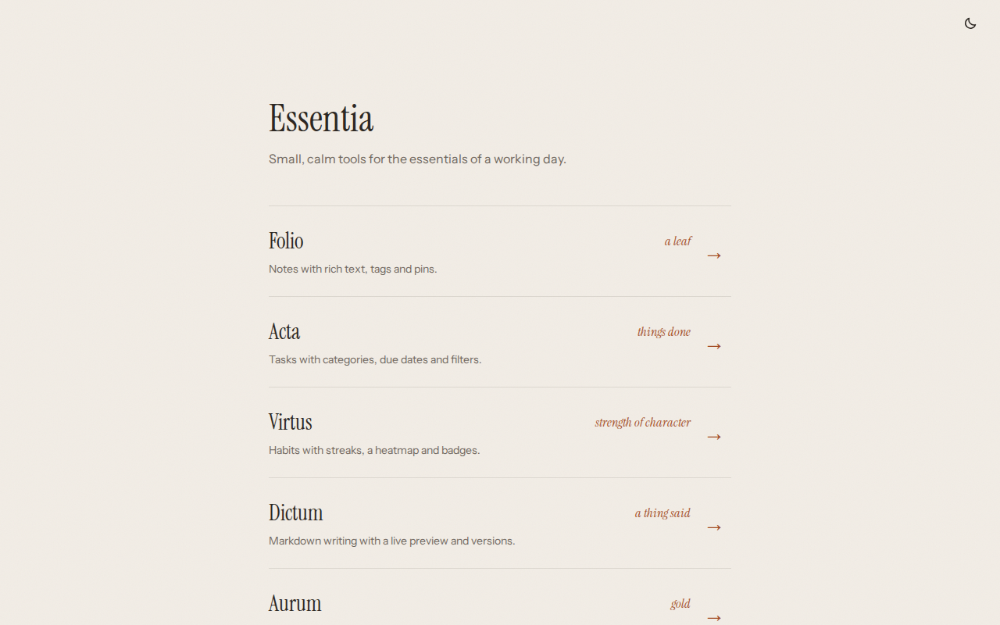
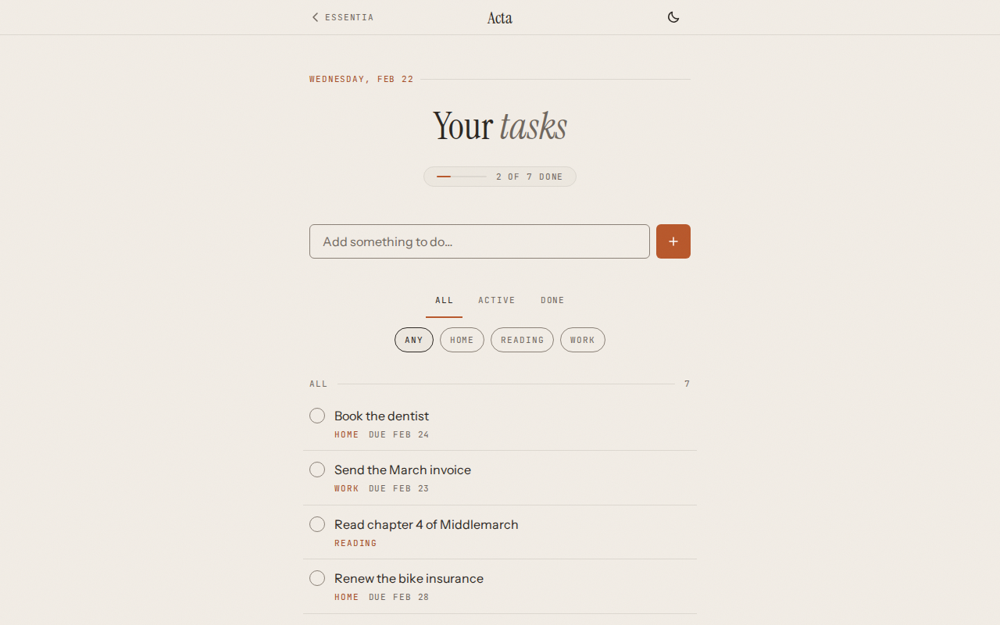
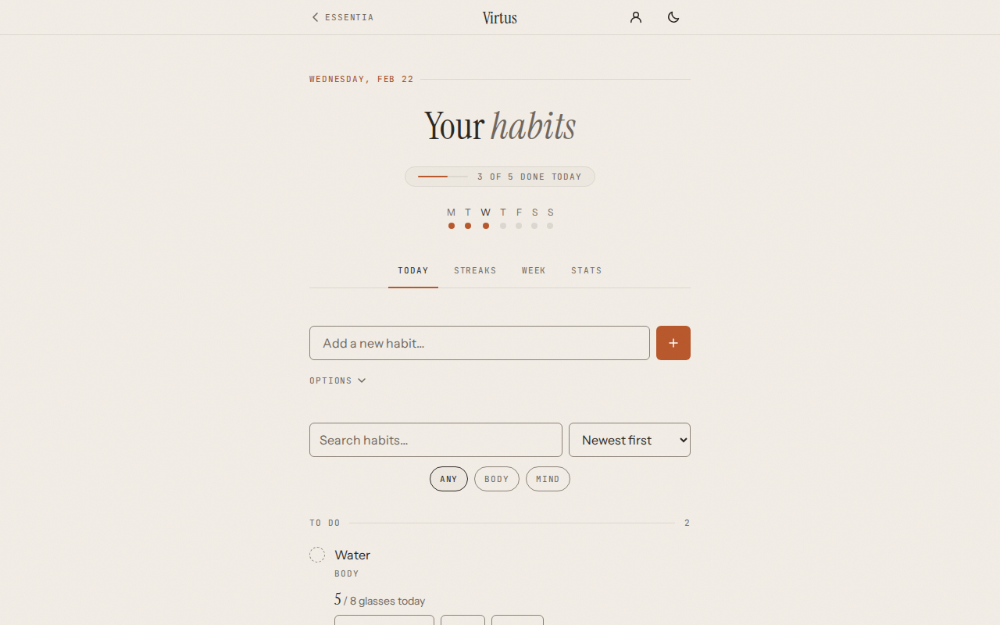
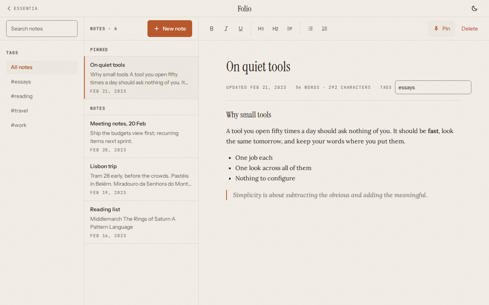
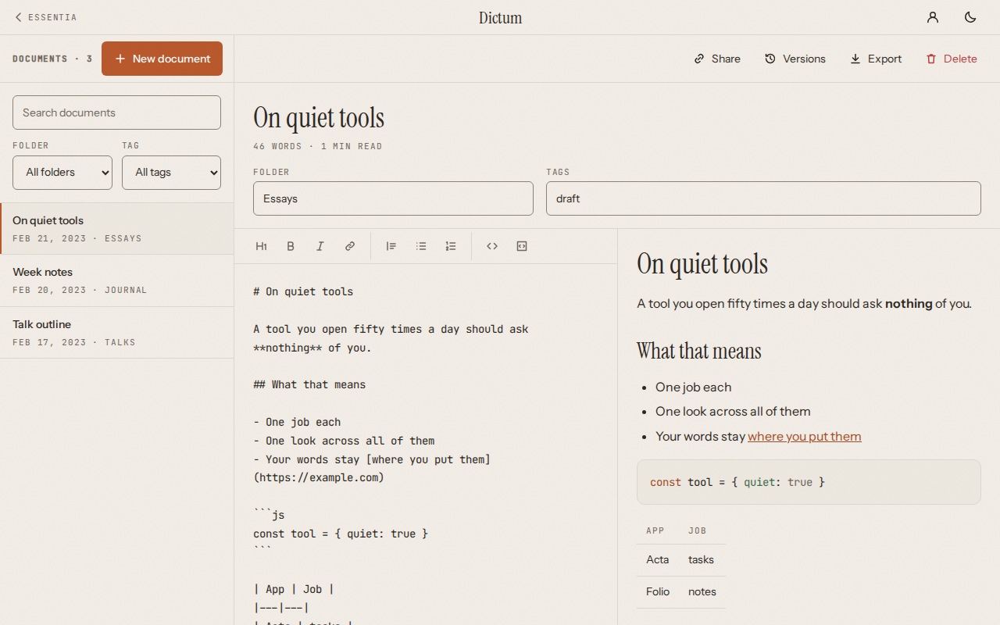
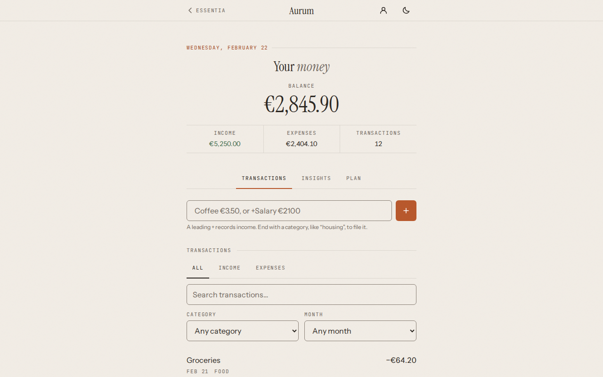
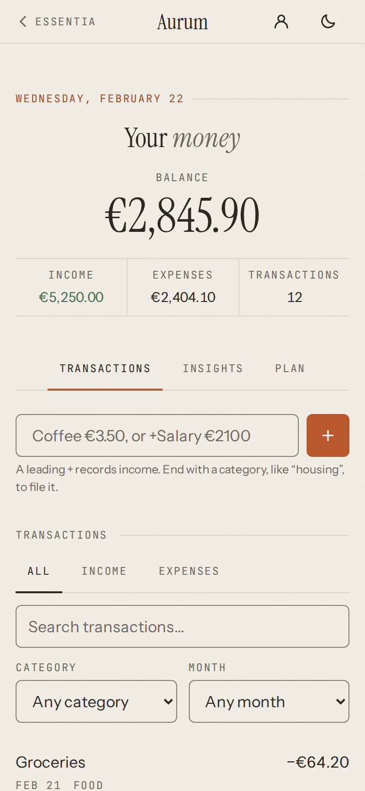

# Essentia

Five small productivity apps that share one design language, served from one
site with a hub at `/`. Live at https://essentia-beta.vercel.app/



| App | Path | What it does | Data |
|---|---|---|---|
| Folio | `/folio/` | Notes with rich text, tags and pins | This device |
| Acta | `/acta/` | Tasks with categories, due dates and filters | This device |
| Virtus | `/virtus/` | Habits with streaks, a heatmap and badges; installs as an app and works offline | This device, synced when signed in |
| Dictum | `/dictum/` | Markdown writing with a live preview, versions and read-only share links | This device, synced when signed in |
| Aurum | `/aurum/` | Income and expenses, budgets, recurring items and insights | Your account (sign-in required) |

One sign-in covers Virtus, Dictum and Aurum, and the light or dark theme you
pick in one app applies to all of them.

| | |
|---|---|
|  |  |
|  |  |
|  |  |

## Stack

React 19, TypeScript and Vite in a pnpm and turbo monorepo; Supabase (Auth and
Postgres with row level security) for the apps that sync; one static build on
Vercel. More in [docs/ARCHITECTURE.md](docs/ARCHITECTURE.md); flows and screens
in [docs/UX_FLOWS.md](docs/UX_FLOWS.md); goals in
[docs/PROJECT_BRIEF.md](docs/PROJECT_BRIEF.md).

```text
apps/          hub at /, and folio, acta, virtus, dictum, aurum each under /<app>/
packages/
  config/      shared TypeScript and ESLint configs
  tokens/      design tokens, fonts and base styles
  ui/          theme, theme toggle, back-to-hub link, dialog
  supabase/    the Supabase client, sign-in form and account menu
scripts/
  assemble.mjs combines every app build into one dist/
```

## Set up

You need Node 24 or later (see `.nvmrc`) and pnpm 11. On Node 24,
`corepack enable` provides the pinned pnpm; otherwise `npm install -g pnpm@11`.

```bash
git clone https://github.com/tiago-espadinha/essentia.git
cd essentia
pnpm install --frozen-lockfile
pnpm dev
```

Open http://localhost:5100. The hub runs there and proxies every app
(ports 5101 to 5105), so the suite runs on one origin as it does in production.
To run a single app: `pnpm --filter <app> dev` (for example `pnpm --filter acta dev`
serves http://localhost:5102/acta/; its link back to the hub needs the full `pnpm dev`).

Without a Supabase project everything except Aurum works: Folio, Acta, Virtus
and Dictum keep their data in the browser, sign-in is hidden, and Aurum says it
is not set up.

### Supabase (for sync and Aurum)

1. Create a project at [supabase.com](https://supabase.com) (the free tier is enough).
2. In the project's SQL editor, run each of these files once. They are independent, so the order does not matter:
   - `apps/virtus/supabase/migration.sql`: habits and check-ins
   - `apps/dictum/supabase/migration.sql`: documents and share links
   - `apps/aurum/supabase/migration.sql`: transactions, budgets and recurring items
3. Under Authentication, URL configuration: set the Site URL to where the suite runs, and add `http://localhost:5100/**` (and your deployed URL followed by `/**`) to the redirect URLs. The confirmation email leads back to the app it was sent from.
4. Copy `.env.example` into the three apps that sync, then fill in the project URL and the publishable (anon) key from the project's API settings. These files are ignored by git.
   ```bash
   for app in virtus dictum aurum; do cp .env.example apps/$app/.env.local; done
   ```
5. Restart `pnpm dev`.

Only the anon key goes into the apps; row level security in the migrations is
what keeps each user's data to themselves. Never put the service role key in
these files.

## Commands

```bash
pnpm dev          # hub and every app at http://localhost:5100
pnpm lint
pnpm typecheck
pnpm test         # Vitest, per app and package
pnpm build        # build everything, then assemble dist/
pnpm preview      # build, then serve dist/ at http://localhost:4173
pnpm audit        # should report no known vulnerabilities
```

Shared dependency versions live in the `catalog` in `pnpm-workspace.yaml`;
packages refer to them as `"catalog:"`.

## Deploy

The suite deploys to Vercel as one static site; `vercel.json` holds the build
command, the security headers and the rewrite for Dictum share links.

1. Import the repository into Vercel. The build settings come from `vercel.json`.
2. Add the environment variables `VITE_SUPABASE_URL` and `VITE_SUPABASE_ANON_KEY` for the build.
3. In `vercel.json`, set the `connect-src` of the Content-Security-Policy to your project's origin (`https://<ref>.supabase.co`), or the apps cannot reach Supabase.
4. Add the deployed URL to the Supabase redirect URLs (step 3 above).

## Known limitations

- Folio and Acta keep data in the browser only; clearing site data removes it.
- Dictum's saved versions stay on the device that saved them; only documents sync.
