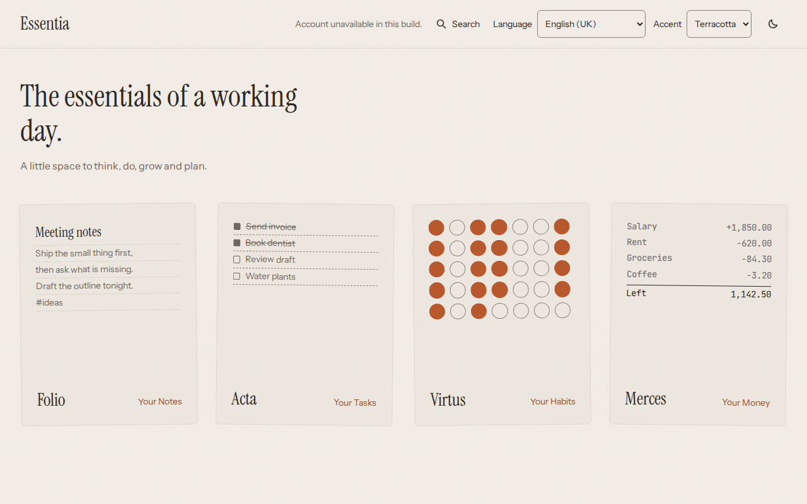
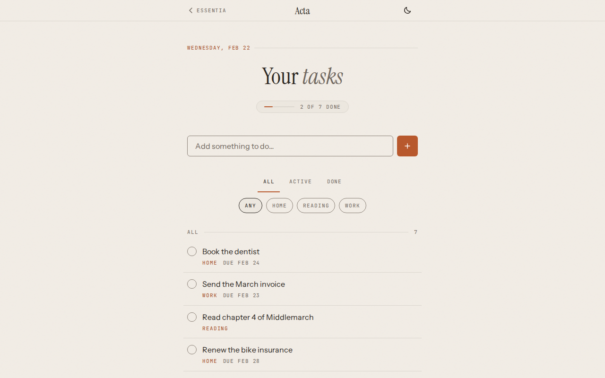
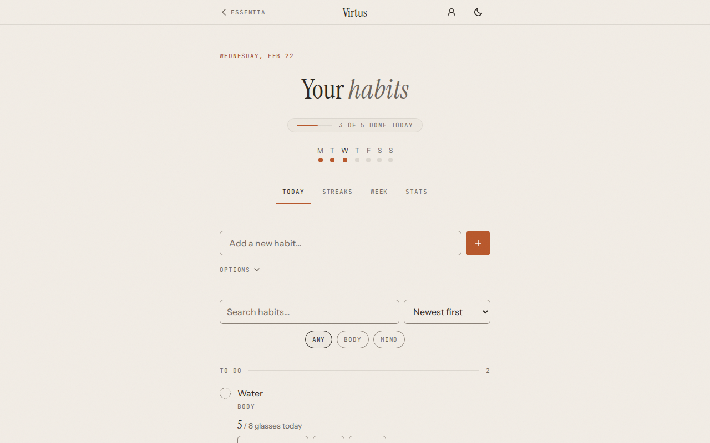
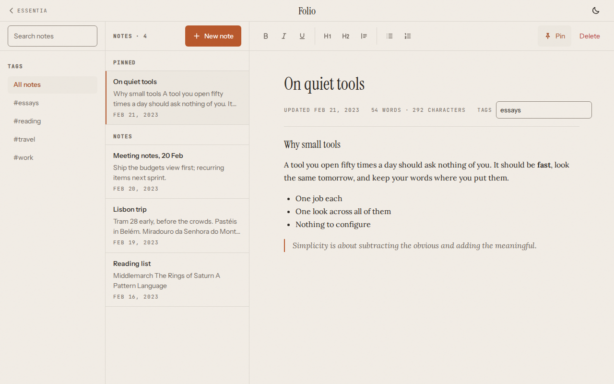
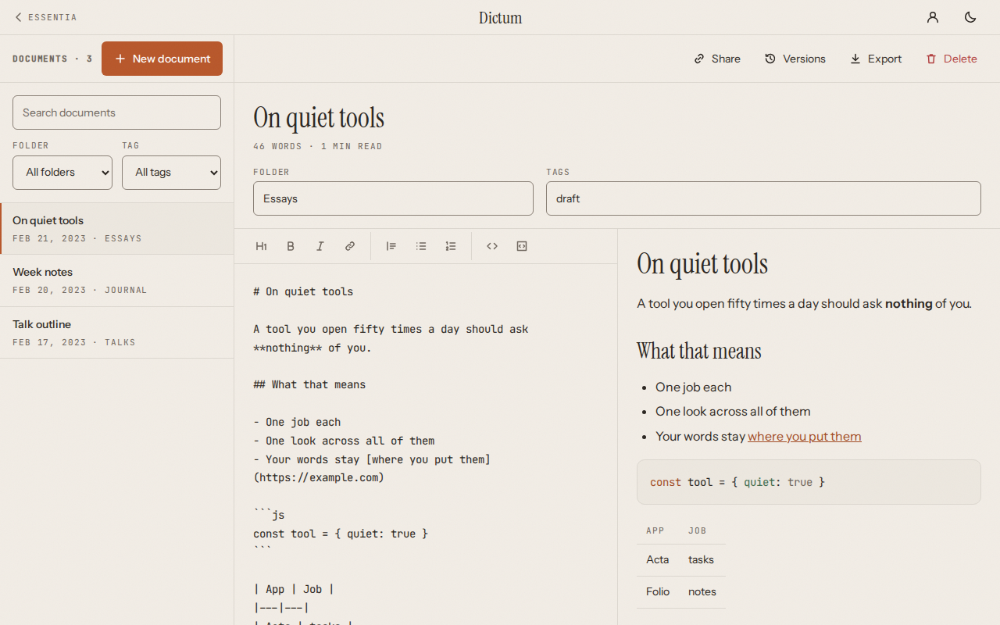
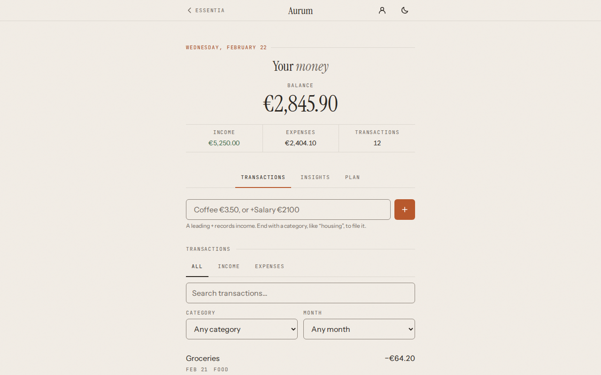
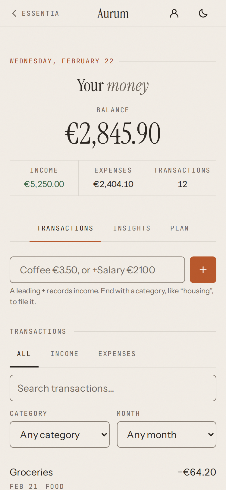

# Essentia

Five small productivity apps that share one design language, served from one
site with a hub at `/`. Built for its author's everyday use and as a portfolio
piece. Live at https://essentia-beta.vercel.app/



| App | Path | What it does | Data |
|---|---|---|---|
| Folio | `/folio/` | Notes in rich text or markdown, with folders, tags, pins and read-only share links | This device, synced when signed in |
| Acta | `/acta/` | Tasks with categories, due dates and filters | This device |
| Virtus | `/virtus/` | Habits with streaks, a heatmap, badges and each habit's full history; installs as an app and works offline | This device, synced when signed in |
| Merces | `/merces/` | Income and expenses, budgets, recurring items, insights and badges | Your account (sign-in required) |

Sign in or open Account from the hub header. Before signing out there, check each
app’s sync: confirmation discards any unsynced account changes and device-only
note versions from this browser. Work made while signed out stays.

Account also offers password changes for confirmed email accounts. Enter your
current password and confirm the new one; if the server requests verification,
send and enter the email code. Forgot your password? The sign-in form links to
recovery on the hub. Other sign-in providers manage their own passwords.

One sign-in covers Folio, Acta, Virtus and Merces, and the light or dark theme you
pick in one app applies to all of them.

Choose English (UK) or Português (Portugal) with Language in the hub header.
The choice stays on this browser and applies across the suite and open tabs.
Dates and amounts follow that locale; money remains in euros. Your notes,
categories and other content keep their original language. Input and CSV rules
stay the same: finance and logged habit amounts accept comma or point
decimals, while a habit's target uses a point. Native browser date controls follow browser settings.

The hub and each app can be installed through a supporting browser's Install
menu (or Add to Home Screen). Visit the entry online first and let its offline
setup finish. Folio, Acta and Virtus then reopen with their
device-local data; the hub also reopens offline. Each app needs its own online
visit: installing the hub does not download every app. Merces requires a
connection for finance writes, and shared notes require one to load.
Close that app's open tabs and installed windows to apply a downloaded update.
Existing `/aurum/` links install the canonical Merces app.

| | |
|---|---|
|  |  |
|  |  |
|  |  |

The app identities are Folio · Your Notes, Acta · Your Tasks, Virtus · Your Habits,
and Merces · Your Money. Existing screenshots above predate these identity updates.

## Stack

React 19, TypeScript and Vite in a pnpm and turbo monorepo; Supabase (Auth and
Postgres with row level security) for the apps that sync; one static build on
Vercel. More in [docs/ARCHITECTURE.md](docs/ARCHITECTURE.md); flows and screens
in [docs/UX_FLOWS.md](docs/UX_FLOWS.md); goals in
[docs/PROJECT_BRIEF.md](docs/PROJECT_BRIEF.md).

```text
apps/          hub at /; folio, acta, virtus, dictum under /<app>/
               aurum builds Merces at /merces/ (also /aurum/)
packages/
  config/      shared TypeScript and ESLint configs
  tokens/      design tokens, fonts and base styles
  ui/          theme, theme toggle, back-to-hub link, dialog
  supabase/    the Supabase client, sign-in form and account menu
scripts/
  assemble.mjs combines every app build into one dist/
```

## Set up

You need Node 24 or later (see `.nvmrc`) and pnpm 11. On Node 24,
`corepack enable` provides the pinned pnpm; otherwise `npm install -g pnpm@11`.

```bash
git clone https://github.com/tiago-espadinha/essentia.git
cd essentia
pnpm install --frozen-lockfile
pnpm dev
```

Open http://localhost:5100. The hub runs there and proxies every app
(ports 5101 to 5105), so the suite runs on one origin as it does in production.
To run a single app: `pnpm --filter <app> dev` (for example `pnpm --filter acta dev`
serves http://localhost:5102/acta/; its link back to the hub needs the full `pnpm dev`).

Without a Supabase project everything except Merces works: Folio, Acta and Virtus
keep their data in the browser, app sign-in is hidden, the hub shows
Account unavailable, and Merces says it is not set up.

### Supabase (for sync and Merces)

1. Create a project at [supabase.com](https://supabase.com) (the free tier is enough).
2. In the project's SQL editor, run each of these files once, Folio's after Dictum's, in this order:
   - `apps/virtus/supabase/migration.sql`: habits and check-ins
   - `apps/dictum/supabase/migration.sql`: documents and share links
   - `apps/folio/supabase/migration.sql`: note format, pinning and kept folders, added to Dictum's documents
   - `apps/folio/supabase/shared-format.sql`: shared notes also say whether they are rich or markdown; run after Folio's migration
   - `apps/aurum/supabase/migration.sql`: transactions, budgets and recurring items
3. Under Authentication, URL configuration: set the Site URL to where the suite runs, and add `http://localhost:5100/**` (and your deployed URL followed by `/**`) to the redirect URLs. The confirmation email leads back to the app it was sent from. Merces now requests `/merces/`; keep both `/merces/` and `/aurum/` allowed if using explicit paths rather than the wildcard.
4. Copy `.env.example` into the hub and the four apps that sync, then fill in the same project URL and publishable (anon) key from the project's API settings. These files are ignored by git.
   ```bash
   for app in hub folio virtus dictum aurum; do cp .env.example apps/$app/.env.local; done
   ```
5. Restart `pnpm dev`.

Password recovery returns to the hub root (`http://localhost:5100/` locally, or
your deployed origin followed by `/`); allow that exact URL in Supabase Auth.
Review the email provider’s password policy, **Secure password change** and
**Require current password** settings. The UI honours server reauthentication
and policy refusals; it does not change those settings. Test recovery with your
settings and email delivery before relying on it. If your server requires the
current password even for recovery, that restriction is shown rather than bypassed.

Only the anon key goes into the apps; row level security in the migrations is
what keeps each user's data to themselves. Never put the service role key in
these files.

## Commands

```bash
pnpm dev          # hub and every app at http://localhost:5100
pnpm lint
pnpm typecheck
pnpm test         # assembly regression, then Vitest per app and package
pnpm build        # build everything, then assemble dist/
pnpm preview      # build, then serve dist/ at http://localhost:4173
pnpm audit        # should report no known vulnerabilities
```

Shared dependency versions live in the `catalog` in `pnpm-workspace.yaml`;
packages refer to them as `"catalog:"`.

## Deploy

The suite deploys to Vercel as one static site; `vercel.json` holds the build
command, the security headers and the rewrites for share links.

1. Import the repository into Vercel. The build settings come from `vercel.json`.
2. Add the environment variables `VITE_SUPABASE_URL` and `VITE_SUPABASE_ANON_KEY` for the build.
3. In `vercel.json`, set the `connect-src` of the Content-Security-Policy to your project's origin (`https://<ref>.supabase.co`), or the apps cannot reach Supabase.
4. Add the deployed URL to the Supabase redirect URLs (step 3 above).

Merces is built from the retained `apps/aurum` workspace (`pnpm --filter aurum dev`).
The assembled site serves the same finance app at `/merces/` and `/aurum/`, with
assets under `/merces/`. Both URLs preserve query strings and fragments. Existing
`essentia-aurum-*` local storage and Supabase tables/session remain unchanged;
there is no data migration. Preview both paths before deploying.

## Known limitations

- Notes kept on a device only, and anything made while signed out, live in the browser; clearing site data removes them.
- Folio's saved versions stay on the device that saved them; only notes sync.
- Deleting a shared note stops its link until the note is restored; the link itself is kept until sharing stops.
- Keyboard use and automated accessibility checks are covered; screen readers (NVDA, VoiceOver) have not been tested.
